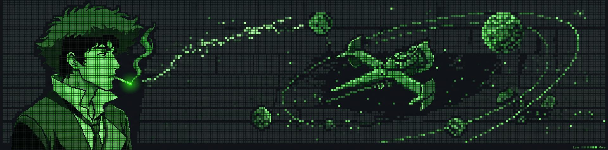

<p align="center">
  
</p>

<p align="center">
  
</p>

<p align="center">
  <a href="https://valentinperies.fr/">
    
  </a>&nbsp;&nbsp;
  <a href="https://www.instagram.com/valentin.peries/">
    
  </a>&nbsp;&nbsp;
  <a href="https://www.linkedin.com/in/valentin-peries/">
    
  </a>
</p>

<br>

###  Terminal d'accès système

```text
vperies@bebop:~$ cat /etc/motd

  +----------+------------------------------------------------------+
  | NAME     | Valentin Peries                                      |
  | ROLE     | Developpeur IA                                       |
  | BASE     | Lyon, France                                         |
  | STUDIES  | Etudiant EPSI Lyon, Master Expert IA et Data science |
  | SEARCH   | Alternance de 2 ans pour ce master, des maintenant   |
  |          | Lyon, hybride ou teletravail                         |
  +----------+------------------------------------------------------+

vperies@bebop:~$ systemctl status current-tasks.service
  current-tasks.service - Active Projects
    Loaded: loaded (/etc/systemd/system/current-tasks.service; enabled)
    Active: active (running) since system boot; 1337 days ago
    Memory: 4.2G (limit: unlimited)
    CGroup: /system.slice/current-tasks.service
    Tasks:
      |- PID 001 [IA]    -> IA de famille sur le NAS (Ollama, 1 RAG par personne)
      |- PID 002 [Web]   -> SevenArtList : watchlist a deux (Next.js, Supabase)
      '- PID 003 [Build] -> MOC LEGO alternatif (Casque L. Hamilton)
```

<br>

###  Missions

```text
vperies@bebop:~$ ./fetch_missions.sh --status=all --decrypt

[+] AUTHENTICATING TO MAINFRAME... ========== SUCCESS
[+] DECRYPTING MISSION FILES...    ========== DONE
[+] DOWNLOADING MISSION LOGS...

+----+----------------------------------------------+--------------+---------------+
| ID | MISSION NAME                                 | TYPE         | STATUS        |
+----+----------------------------------------------+--------------+---------------+
| 01 | NUTRI-PREDICT                                | [FULL-STACK] | > DONE        |
|    | -> Variation de poids d'une portion.         |              |               |
|    |    Certification RNCP 2026.                  |              |               |
|    |    R2 0,985 sur donnees simulees.            |              |               |
|    |    Regression lineaire : 0,959.              |              |               |
+----+----------------------------------------------+--------------+---------------+
| 02 | WILDAIPRINT                                  | [VISION]     | > RE-TESTED   |
|    | -> 83 % annonces, 26 % sur un vrai jeu       |              |               |
|    |    de test (38 photos). Fuite corrigee.      |              |               |
|    |    github.com/Rateur/WildAIprint-Modele-CNN  |              |               |
|    |    github.com/Rateur/wildaiprint-App         |              |               |
+----+----------------------------------------------+--------------+---------------+
| 03 | OBSERVATOIRE DE LA PARITE                    | [DATA]       | > DEPLOYED    |
|    | -> 33 chaines sur 35 en 2020 : les femmes    |              |               |
|    |    parlent moins de la moitie du temps.      |              |               |
|    |    github.com/Rateur/opendata                |              |               |
|    |    opendata2025.netlify.app                  |              |               |
+----+----------------------------------------------+--------------+---------------+
| 04 | IA DE FAMILLE                                | [IA LOCALE]  | > IN PROGRESS |
|    | -> Assistant sur le NAS de la maison.        |              |               |
|    |    Ollama, 1 RAG par personne,               |              |               |
|    |    0 octet dans le cloud.                    |              |               |
+----+----------------------------------------------+--------------+---------------+
| 05 | SEVENARTLIST                                 | [FULL-STACK] | > IN PROGRESS |
|    | -> Watchlist a deux, synchronisee en         |              |               |
|    |    temps reel (Next.js, Supabase).           |              |               |
|    |    github.com/Rateur/SevenArtList            |              |               |
+----+----------------------------------------------+--------------+---------------+
```

<br>

###  Stack Technique

```text
vperies@bebop:~$ tree /mnt/brain/skills --dirsfirst

/mnt/brain/skills
|-- IA & ML
|   |-- Modelisation ... scikit-learn, TensorFlow, Keras, MLflow
|   '-- GenAI .......... LLM, MCP, n8n
|
|-- Data
|   '-- Data ........... Python, Pandas, NumPy, Streamlit
|
|-- Back & MLOps
|   |-- Back-End ....... FastAPI, Flask, SQL, SQLite
|   '-- Ops ............ Docker, CI/CD, pytest
|
'-- Interface
    '-- Front-End ...... Next.js, React, Three.js, WebGL

4 directories, 6 modules -- all systems nominal
```

<br>

###  Stats


<p align="center">
  <picture>
    <source media="(prefers-color-scheme: dark)" srcset="https://raw.githubusercontent.com/Rateur/Rateur/output/github-contribution-grid-snake-dark.svg">
    <source media="(prefers-color-scheme: light)" srcset="https://raw.githubusercontent.com/Rateur/Rateur/output/github-contribution-grid-snake.svg">
    
  </picture>
</p>

<br>

###  Now Playing

<a href="https://spotify-github-profile.kittinanx.com/api/view?uid=31ab6e4pjziu6puiila6fgmlnepa&redirect=true">
  
</a>

<br>

###  Secure Commlink

```text
vperies@bebop:~$ ./init_commlink.sh --encrypt --protocol=TLS1.3

[+] GENERATING 4096-BIT RSA KEYS... ========== DONE
[+] ESTABLISHING ENCRYPTED TUNNEL...
[+] HANDSHAKE COMPLETE

    +------------+--------------------------------------+
    | LINKEDIN   | linkedin.com/in/valentin-peries      |
    | E-MAIL     | contact@valentinperies.fr            |
    | WEBSITE    | valentinperies.fr                    |
    +------------+--------------------------------------+

> SIGNAL STRENGTH: ========.. 82%
> CONNECTION: SECURE
> END OF TRANSMISSION.
```

<br>

<p align="center">
  
</p>
