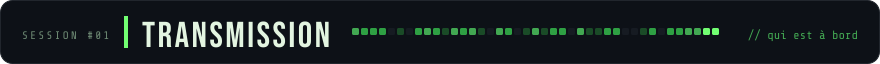
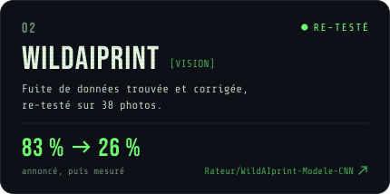
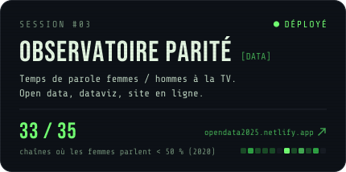
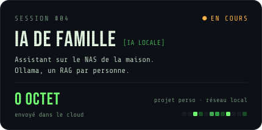
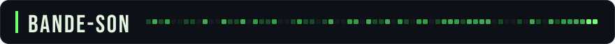

  

&nbsp;
&nbsp;
&nbsp;

 

Développeur IA, en **Master Expert IA & Data Science à l'EPSI Lyon**.
J'entraîne des modèles, je les teste sur de vraies données (même quand le score baisse), puis je construis l'app autour : FastAPI côté back, Next.js côté front.

En ce moment : **Sumi**, mon nouveau projet en **React**.

Je cherche une **alternance de 2 ans**, à Lyon, en hybride ou en télétravail, **dès maintenant**.

Hors mission : un MOC LEGO alternatif, le casque de L. Hamilton.

 

  

  
  
  
  
  
  

Code : <a href="https://github.com/Rateur/WildAIprint-Modele-CNN">WildAIprint (modèle)</a> ·
<a href="https://github.com/Rateur/wildaiprint-App">WildAIprint (app)</a> ·
<a href="https://github.com/Rateur/opendata">Observatoire de la parité</a> ·
<a href="https://github.com/Rateur/SevenArtList">SevenArtList</a>

 

  

 

  <picture>
    <source media="(prefers-color-scheme: dark)" srcset="https://raw.githubusercontent.com/Rateur/Rateur/output/github-contribution-grid-snake-dark.svg">
    <source media="(prefers-color-scheme: light)" srcset="https://raw.githubusercontent.com/Rateur/Rateur/output/github-contribution-grid-snake.svg">
    
  </picture>

 

  

 

  

<!-- Les SVG de ./assets sont générés par tools/build_assets.py : modifier les données en haut du script, puis relancer. -->
